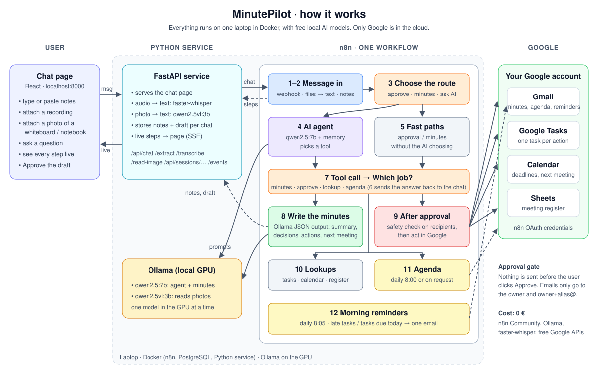
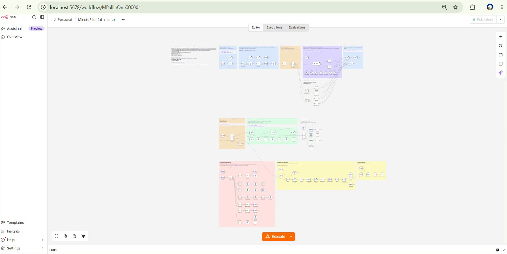
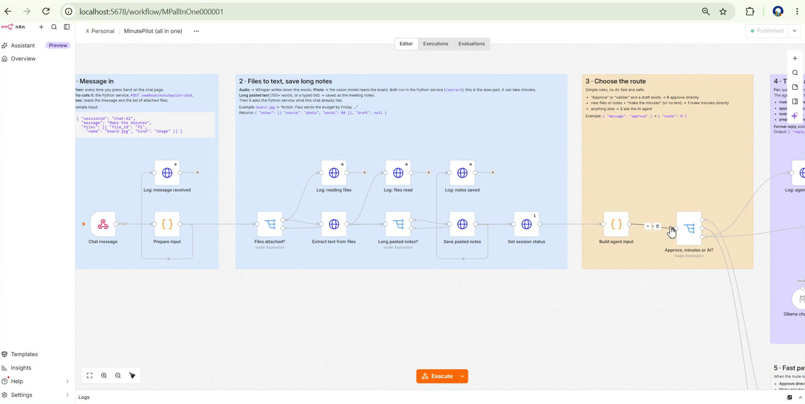
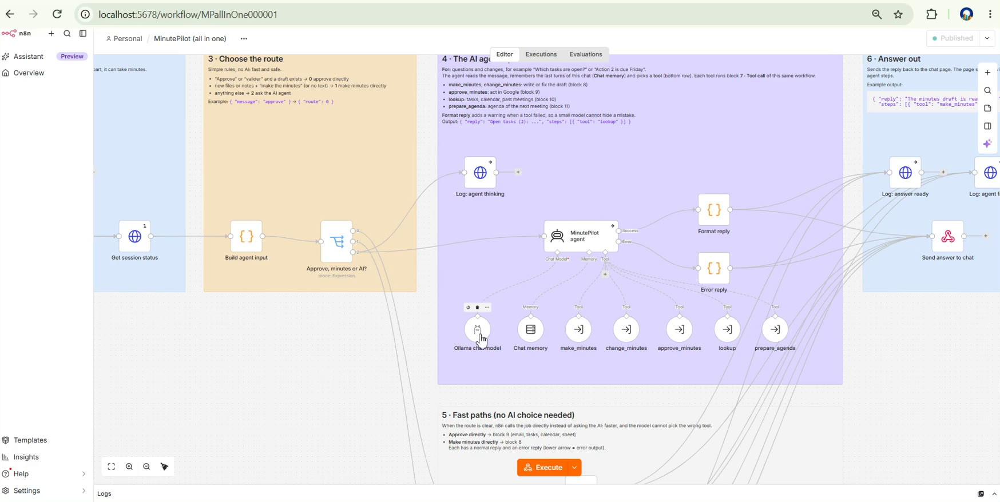
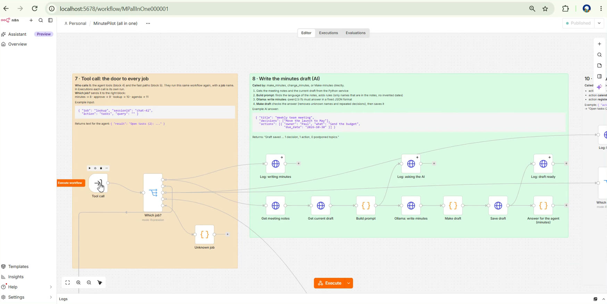
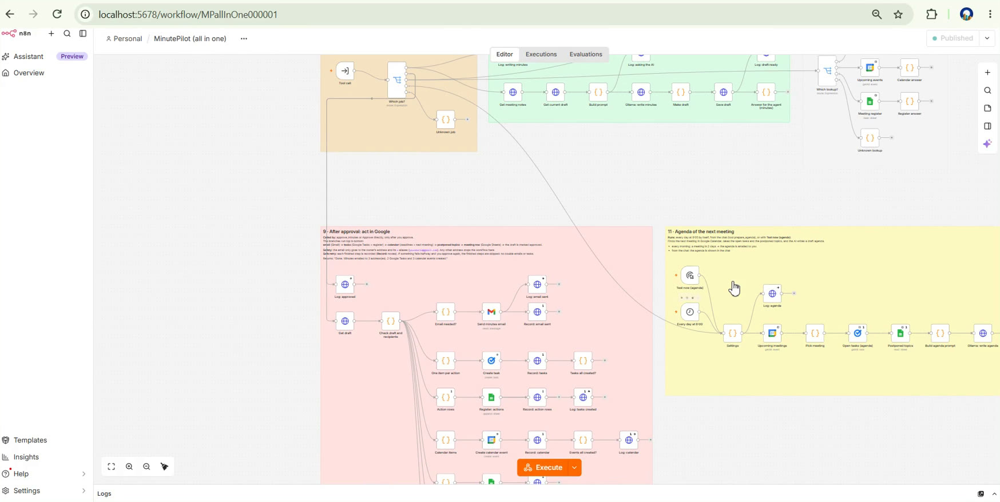
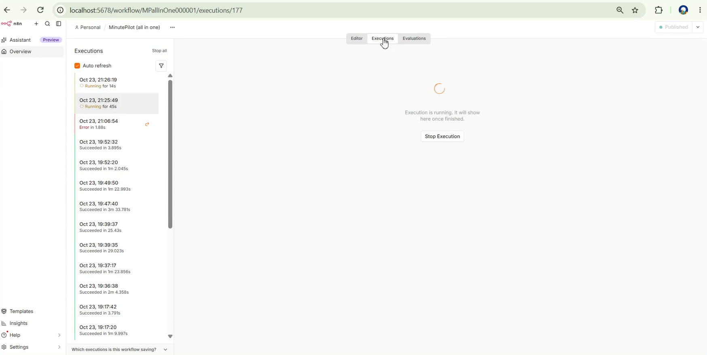
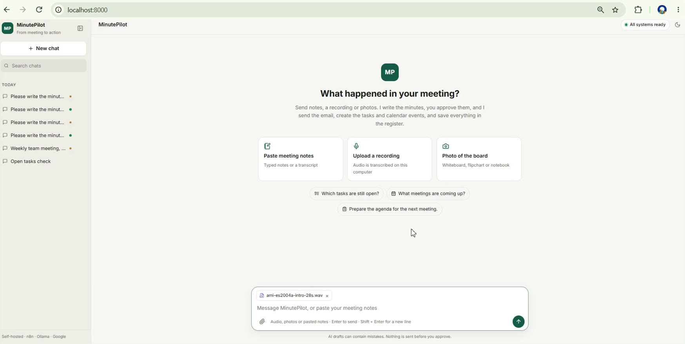
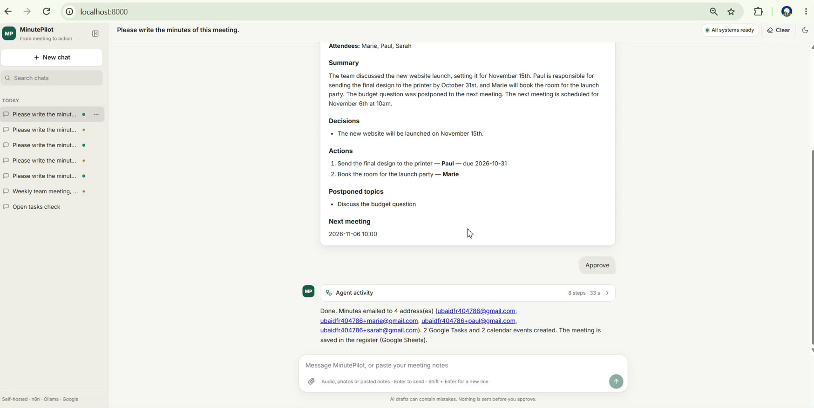
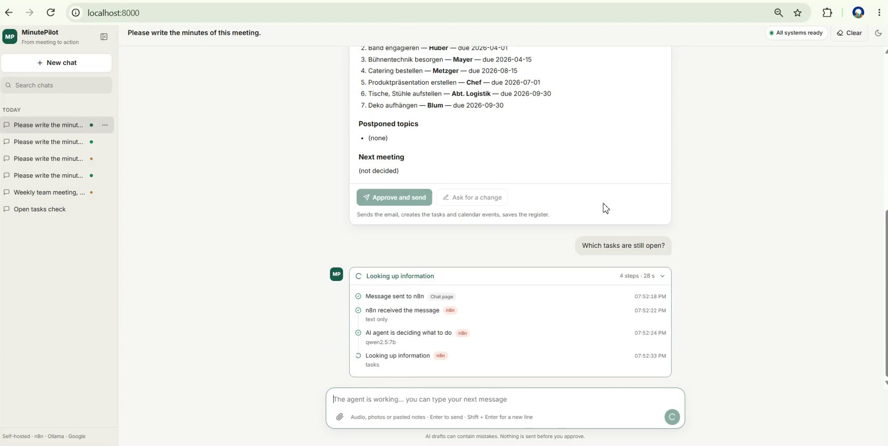

# MinutePilot

**From meeting to action, automatically. Free AI models, running on one laptop.**

Send a meeting to a chat page (a recording, a photo of the whiteboard, or your notes). MinutePilot writes the minutes, and once you approve them it sends the email, creates the tasks, puts the deadlines in the calendar and fills in the meeting register.

Built with n8n, a small FastAPI service, Ollama and Google APIs. Running it costs nothing.

---

## The problem

After every meeting, somebody has to:

1. collect what was said: a recording, typed notes, a photo of the whiteboard, a notebook page
2. write clean minutes
3. send them to everyone
4. turn each decision into a task with an owner and a due date
5. put the deadlines and the next meeting in the calendar
6. remember the topics that were postponed

This takes hours, and things get forgotten. Paid tools exist, but they send company meetings to someone else's cloud and charge for every user.

**MinutePilot does steps 2 to 6.** You chat with it, read the draft and click **Approve**. The AI models run on your own machine, and nothing is sent until you approve.

---

## Demo video (2 min 33 s)


https://github.com/user-attachments/assets/0f5300f9-bd2f-420b-8342-a26468aa9f7b


The video shows:
- a recording turned into minutes;
- the approval step, then the email in Gmail, the events in Calendar and the rows in Sheets;
- a German flipchart photo read by the vision model;
- a question answered by the agent.

All of it runs on a laptop with a 6 GB graphics card, at a cost of 0 €.

---

## Architecture



| Part | What it does | Technology |
|---|---|---|
| **Chat page** | Chats list, file upload, the draft with **Approve and send**, and every agent step shown live | React (Vite), served by the Python service |
| **Python service** | Speech to text and photo to text; stores the notes, draft and live steps of each chat | FastAPI, faster-whisper `small`, Server-Sent Events |
| **n8n workflow** | The whole back end in one workflow: routing, AI agent, minutes, approval, Google actions, schedules | n8n Community (self-hosted), PostgreSQL |
| **AI models** | Agent and minutes writing; reading photos | Ollama: `qwen2.5:7b`, `qwen2.5vl:3b` |
| **Google** | Email, tasks, calendar, meeting register | Gmail, Google Tasks, Google Calendar, Google Sheets (n8n OAuth) |

### Inside the n8n workflow

The whole back end is **one n8n workflow**, `n8n/workflows/minutepilot.json`. It has 12 coloured blocks, and each block has a note saying what it does, when it runs, and an example of its input and output.



| Block | Colour | Starts when | What it does |
|---|---|---|---|
| 1–2 · Message in | blue | the chat page sends a message | Webhook. Attached audio and photos go to the Python service and come back as text. A long paste is saved as notes. |
| 3 · Choose the route | orange | after 1–2 | Simple rules choose between approve, make minutes and ask the AI |
| 4 · AI agent | purple | questions and changes | `qwen2.5:7b` with chat memory chooses a tool: make or change the minutes, approve, lookup, agenda |
| 5 · Fast paths | grey | an approval or a "minutes please" message | Goes straight to the job, without the AI choosing, so sending an email never depends on a small model |
| 6 · Answer out | blue | after 4 or 5 | Sends the reply and the tools used back to the chat page |
| 7 · Tool call | orange | a tool or a fast path | **Which job?** sends the call to block 8, 9, 10 or 11 |
| 8 · Write the minutes | green | job *minutes* | Ollama with a JSON schema returns the summary, decisions, actions (owner, due date), postponed topics and next meeting |
| 9 · After approval | red | job *approve* | Checks the recipients, then: Gmail → one Google Task per action → Calendar events → rows in the register. Steps already done are skipped on a retry, so nothing is sent twice. |
| 10 · Lookups | grey | job *lookup* | Open tasks, upcoming events, search in past meetings |
| 11 · Agenda | yellow | every day at 8:00, or on request | Postponed topics and open tasks become a draft agenda, emailed 2 days before a meeting |
| 12 · Morning reminders | yellow | every day at 8:05 | Late tasks and tasks due today, in one email |

Each block also has **Log:** nodes, which send each step to the chat page as it happens.

| Message in and routing (blocks 1–3) | AI agent and its tools (block 4) |
|---|---|
|  |  |
| **Tool call and minutes (blocks 7–8)** | **Google actions and schedules (blocks 9–12)** |
|  |  |

While the AI is working, the run shows as *Running* in n8n's **Executions** tab:



### The chat page

| Start | Approved minutes | Asking a question |
|---|---|---|
|  |  |  |

### Safety rules built in

- **Nothing is sent before approval.** The AI only writes a draft.
- **Your own email only.** Recipients must be the owner's address or one of its `+` aliases (`you+marie@gmail.com`). Any other address stops the workflow.
- **Safe to retry.** If one Google step fails, approving again only runs the steps that did not finish.

---

## How I set it up

**Machine used:**
- Windows 11, Intel i5-13420H, 7.6 GB RAM, NVIDIA RTX 3050 with 6 GB;
- Docker Desktop, with WSL limited to 4 GB;
- Ollama for Windows, running on the GPU.

Only one AI model fits in the GPU at a time, so audio, photos and writing run one after another.

### 1. Requirements

- [Docker Desktop](https://www.docker.com/products/docker-desktop)
- [Ollama](https://ollama.com/download)
- Git
- A Google account

```powershell
ollama pull qwen2.5:7b
ollama pull qwen2.5vl:3b
```

### 2. Google Sheet (the meeting register)

Create a spreadsheet with three tabs, with these headers in row 1:

| Tab | Columns |
|---|---|
| `Meetings` | meeting_id, date, title, attendees, summary, decisions, postponed, next_meeting, approved_at |
| `Actions` | meeting_id, meeting_date, action, owner, owner_email, due_date, task_id, created_at |
| `Postponed` | meeting_id, meeting_date, topic, status |

### 3. Google OAuth client

1. In Google Cloud Console, create a project.
2. Enable the **Gmail**, **Calendar**, **Tasks**, **Sheets** and **Drive** APIs.
3. Set the consent screen to **External**, in **Testing** mode, and add your Gmail account as a test user.
4. Create an OAuth client of type **Web application**, with this redirect URI:

```
http://localhost:5678/rest/oauth2-credential/callback
```

### 4. Settings

```powershell
git clone https://github.com/ubaidur404786/minutepilot.git
cd minutepilot\docker
copy .env.example .env
```

Fill in `.env`:

| Variable | Value |
|---|---|
| `POSTGRES_PASSWORD` | any password |
| `N8N_ENCRYPTION_KEY` | a long random string; keep it, because n8n encrypts the saved credentials with it |
| `OWNER_EMAIL` | your Gmail address |
| `SHEET_ID` | the ID of the Google Sheet, taken from its URL |
| `GOOGLE_CLIENT_ID`, `GOOGLE_CLIENT_SECRET` | from step 3 |

`.env` is git-ignored.

### 5. Start the stack

```powershell
docker compose --env-file .env up -d --build
powershell -ExecutionPolicy Bypass -File setup-n8n.ps1
```

`setup-n8n.ps1` imports 5 credentials (Ollama and 4 Google ones) and the workflow, then publishes the workflow.

Next, in n8n (http://localhost:5678), open **Credentials**, then open each of the 4 Google credentials and click **Sign in with Google**.

---

## How I run it

| URL | What |
|---|---|
| http://localhost:8000 | MinutePilot chat page. The top right shows *All systems ready*. |
| http://localhost:5678 | n8n: the workflow and its executions |
| http://localhost:8000/health | `{"ok":true}` |

1. Open the chat page.
2. Paste notes, or attach a recording or a photo, and write *"Please write the minutes of this meeting."*
3. Watch the steps live, and read the draft.
4. Click **Approve and send**, or ask for a change, for example *"action 1 is due Friday"*.
5. Ask questions: *"Which tasks are still open?"*, *"When is the next meeting?"*, *"Prepare the agenda for the next meeting."*

To run the quick test set (fake meetings; nothing is approved or sent):

```powershell
python test-data\quick\run_quick_tests.py
```

To run the unit tests for the Python service:

```powershell
cd python-service
python -m pytest -q tests
```

To stop or start the stack, from the `docker\` folder:

```powershell
docker compose stop
docker compose --env-file .env up -d
```

After you change the workflow JSON, run `setup-n8n.ps1 -WorkflowsOnly`. This keeps your Google sign-ins.

---

## Project structure

```
minutepilot/
├── docker/              docker-compose.yml, .env.example, setup-n8n.ps1
├── n8n/workflows/       minutepilot.json: the whole back end in one workflow
├── python-service/
│   ├── app/             FastAPI: chat API, /transcribe, /read-image, /extract, session store
│   ├── web/             React chat page (built inside the Docker image)
│   ├── tests/           pytest
│   └── Dockerfile
├── test-data/           fake meetings and open datasets (sources and licenses in SOURCES.md)
└── docs/
    ├── architecture.svg
    ├── demo/            demo video and captions
    ├── images/          screenshots
    └── test-results.md  real test results, including failures
```

---

## Results and limits

Every test result, including the failures, is in [`docs/test-results.md`](docs/test-results.md).

- **Speed.** On this laptop, a 90 s recording takes about 90 s to transcribe, and a photo takes about 4 minutes to read. A stronger GPU is much faster.
- **Mistakes.** Small free models sometimes get numbers wrong, or invent dates or owners. This is why a human approves every draft.
- **Handwriting.** Photos of handwriting are not always read correctly.
- **Test data.** Only fake meetings and open public datasets were used. All emails went to my own Gmail aliases.
- **Licence.** n8n Community Edition is free to self-host, but its licence limits reselling n8n itself as a hosted service.

### Swapping in stronger models

The text model is one setting (`TEXT_MODEL`) and the vision model is another (`VISION_MODEL`). A company could:
- use a bigger self-hosted model, or a hosted API, without changing the workflow;
- swap Gmail and Calendar for Microsoft 365, since n8n also has Outlook and Microsoft To Do nodes.
